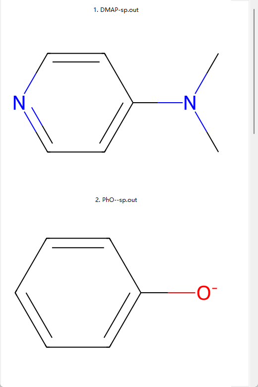

# Gaussian 热力学数据批处理工具（ThermoBatch）

> 基于 [Shermo](http://sobereva.com/552) 的 Gaussian 16 输出批量热化学计算工具，带图形界面，并可用 RDKit 直接预览每个分子的 2D 结构式。


> English: A Windows GUI tool for batch-processing Gaussian 16 frequency and single-point outputs with Shermo, with RDKit 2D structure preview.

## 功能特点

- **一键批处理**：扫描一个文件夹，自动识别频率任务和单点能任务，批量计算吉布斯自由能。
- **按坐标自动配对**：不依赖文件名，只要频率和单点使用的是同一几何，就能自动对应上。
- **真实的 Shermo 计算**：把单点能写入 `setting.ini` 后调用 Shermo 重新计算，结果与手动使用 Shermo 一致。
- **ZPE 缩放因子可调**：默认 0.961，可填入自己方法对应的值。
- **单位与相对能量**：支持 Hartree、kcal·mol⁻¹、kJ·mol⁻¹，并可指定基准物计算相对 G。
- **结构式预览**：RDKit 读取 Gaussian 的 `Symbolic Z-matrix`，自动推断键级并绘制 2D 结构式，支持鼠标滚轮浏览。
- **纯本地运行**：不联网、不上传数据，也不会修改原始 Gaussian 输出文件。

## 界面预览



<!-- 主界面截图（可选，发布时可补一张放到 images/main-window.png 后取消注释）：

-->

## 工作原理

1. 读取文件夹内每个 `.out` / `.LOG` 文件；
2. 用 `Normal termination of Gaussian 16` 判断任务是否正常结束；
3. 含 `Thermal correction to Gibbs Free Energy=` 的记为频率任务，恰好出现一次 `SCF Done` 的记为单点任务；
4. 取两个文件最后一个 `Standard orientation` 坐标块，若逐字符一致则配对（对应“优化后在同一几何上做频率和单点”的常规做法）；
5. 把单点能、ZPE 缩放因子等参数写入 `setting.ini`，调用 `Shermo.exe`，从输出中读取 `Sum of electronic energy and thermal correction to G`；
6. 按所选单位换算显示；RDKit 从 `Symbolic Z-matrix` 取坐标，推断化学键后生成 2D 结构式。

## 输入文件要求

| 条件 | 说明 |
|---|---|
| 文件后缀 | `.out`（小写）或 `.LOG`（大写） |
| 正常结束 | 含 `Normal termination of Gaussian 16` |
| 频率任务 | 含 `Thermal correction to Gibbs Free Energy=` |
| 单点任务 | 恰好一次 `SCF Done` |
| 几何一致 | 频率与单点的最后一个 `Standard orientation` 坐标逐字符一致 |
| 支持版本 | Gaussian 16（G09 未测试） |

> 把所有 freq / sp 输出放在同一个文件夹即可；程序不会递归子文件夹，也不会按文件名配对。

## 快速开始

### 方式一：使用打包好的 exe

1. 从 Releases 下载压缩包并解压；
2. 确保 `Shermo.exe` 与主程序在同一目录（使用内置 Shermo 的单文件版则无需额外操作）；
3. 双击主程序运行。

### 方式二：源码运行

需要 Python 3.9+、RDKit 和 Pillow：

```bat
conda create -n thermo python=3.11 -y
conda activate thermo
conda install -c conda-forge rdkit pillow -y

:: 从 http://sobereva.com/552 下载 Shermo.exe，放到 main.py 同目录
python main.py
```

## 使用步骤

1. 点击「选择文件夹」，选择存放 Gaussian 输出的目录；
2. 在左上角选择输出单位（Hartree / Kcal / KJ）；
3. 在输入框填入 ZPE 缩放因子（默认 0.961，请按所用方法确认）；
4. 点击「运行」，等待日志区输出每个分子的 G；
5. 如需相对能量，在右侧输入基准物编号（从 1 开始），点击「右侧选择基准物编号」；
6. 点击「show structure」查看所有分子的结构式，鼠标滚轮可上下浏览。

> `setting.ini` 由程序在运行目录自动生成并覆盖；它只用于 Shermo 计算，与 Gaussian 输入文件无关。

## 输出说明

日志中每条记录格式为：

```
序号  频率文件名  单点文件名  吉布斯自由能
1     A.out       A-sp.out    -382.12345678
```

单位由界面选择决定，基准物差值也使用同一单位。

## 常见问题（FAQ）

### 1. 为什么有些文件没有被识别？
依次检查：后缀是否为 `.out` / `.LOG`；是否以 `Normal termination of Gaussian 16` 结束；频率文件是否含 `Thermal correction to Gibbs Free Energy=`；单点文件是否恰好只有一次 `SCF Done`。

### 2. 为什么频率和单点没有配对成功？
两者最后一个 `Standard orientation` 坐标必须一致。若单点任务重新优化过、使用了不同构象，或输出文件被截断，都无法配对。

### 3. 提示 `shermo.exe run time error`
确认 `Shermo.exe` 位于程序目录（或当前工作目录）；确认 `setting.ini` 所在目录可写；确认该输出是 Shermo 支持的格式。

### 4. 结构式画不出来
绘制依赖 Gaussian 输出中的 `Symbolic Z-matrix` 和 RDKit。若该段缺失、坐标异常，或分子含 RDKit 难以推断键级的金属/特殊价态，可能失败；不影响能量计算。

### 5. 数值和手动运行 Shermo 不一致？
程序会把单点能写入 `setting.ini` 的 `E` 后调用 Shermo，并采用 298.15 K、1 atm、低频 100 cm⁻¹ 等 Shermo 默认设置。如您的条件与默认设置不同，请至`setting.ini`手动修改。
### 6. 程序会修改我的 Gaussian 文件吗？
不会，只读取。程序唯一写入的文件是运行目录下的 `setting.ini`。

### 7. 支持多个分子的能量相加吗？
不支持。基准物功能只做单分子之间的相对能量相减；多分子求和需自行处理。

## 已知限制

- 仅提供 Windows 图形界面；
- 仅适配 Gaussian 16 的输出格式；
- 依赖 `Standard orientation` 坐标完全一致来配对；
- 结构式为 2D 示意，不保证立体化学标注准确；
- 文件夹内文件较多时，配对是 O(n²) 比较，但速度仍可接受。

## 项目结构

```
.
├── main.py               # 主程序（GUI + 批处理 + RDKit 结构式）
├── Shermo.exe            # 热化学计算引擎（需自行下载，不随仓库分发）
├── setting.ini           # 运行时自动生成
├── images/               # README 截图
└── README.md
```

## 引用

如果本程序对你的工作有帮助，请引用 Shermo：

```bibtex
@article{Lu2021Shermo,
  author  = {Lu, Tian and Chen, Qinxue},
  title   = {Shermo: A general code for calculating molecular thermochemistry properties},
  journal = {Computational and Theoretical Chemistry},
  volume  = {1200},
  pages   = {113249},
  year    = {2021},
  doi     = {10.1016/j.comptc.2021.113249}
}
```

- Shermo 主页与教程：<http://sobereva.com/552>
- RDKit：<https://www.rdkit.org>

## 致谢

感谢 Tian Lu（Sobereva）开发并免费提供 Shermo；感谢 RDKit 开源社区。

## 许可证

本项目代码采用 MIT 许可证。Shermo 的版权归原作者所有，本仓库不包含其源代码。

## 反馈

欢迎通过 GitHub Issues 或计算化学公社帖子反馈问题、提出建议。
